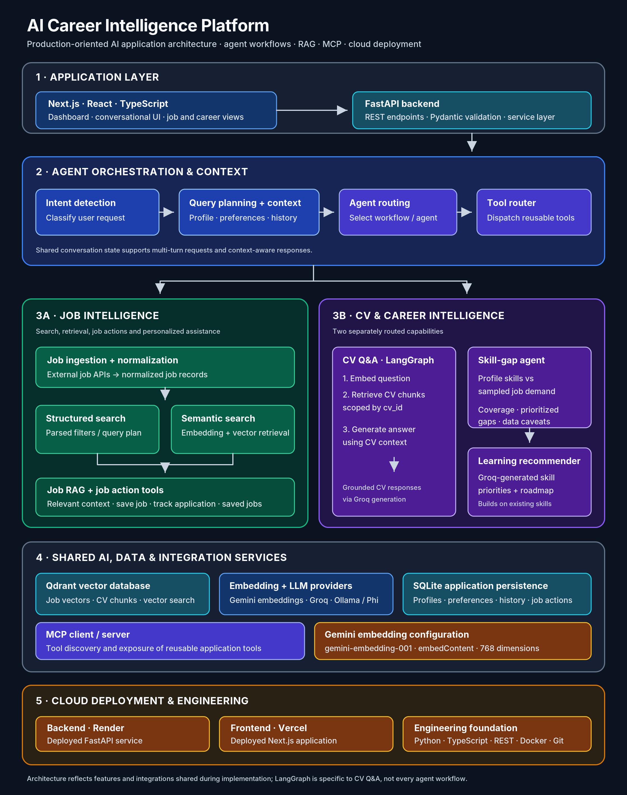

# AI Career Intelligence Platform

An AI-powered career intelligence platform built to support job discovery, intelligent search, CV question answering, skill-gap analysis, and job-application workflows.

The platform combines LLM-powered agents, RAG, semantic retrieval, vector search, persistent user context, tool execution, LangGraph workflow orchestration, and MCP integration.

**Status:** Active Development  
**Core AI Workflows:** Implemented; validation varies by workflow  
**Career Intelligence Features:** Expanding

---

## Architecture Overview

<p align="center">
  
</p>

The architecture diagram shows the implemented job-search and CV-intelligence workflows, shared AI/data services, MCP integration, and the current Render/Vercel deployment. Full CV upload and parsing, secure guest sessions, and end-to-end CV-driven job matching remain roadmap work and are not presented as completed features.

The platform uses a separate **Next.js, React, and TypeScript** application for its dashboard and conversational interface. It connects to the FastAPI backend for job-search and AI workflow responses. The frontend source is maintained in the [web application repository](https://github.com/subodhin/ai-job-assistant-ui); it is part of this platform's full-stack implementation rather than a separate product.

---

## Quick Start

### Clone

```bash
git clone https://github.com/subodhin/rag-job-intelligence-system.git
cd rag-job-intelligence-system
```

### Create and activate virtual environment

```bash
python3 -m venv env
source env/bin/activate
```

### Start Qdrant

```bash
docker run -p 6333:6333 -p 6334:6334 qdrant/qdrant
```

### Start the API

```bash
python -m app.main
```

### Open Swagger UI

```text
http://localhost:8000/docs
```

---

## What I Built

| Engineering Area | Implementation |
|:---|:---|
| **AI Agents** | Intent detection · request routing · tool execution · workflow actions |
| **LLM Orchestration** | Groq for intent/planning and generation · Ollama/Phi for local generation |
| **RAG** | Retrieval · context construction · grounded generation |
| **Job Semantic Retrieval** | `nomic-embed-text` · 768-dimensional embeddings · similarity search (existing job-search path) |
| **Gemini Embeddings** | Google Gemini `gemini-embedding-001` · `embedContent` API · configurable task type · 768-dimensional output |
| **CV Question Answering** | CV-specific retrieval-augmented question answering |
| **CV Vector Retrieval** | CV-scoped Qdrant search using `cv_id` and query embeddings |
| **LangGraph** | Stateful CV Q&A workflow using nodes, shared state, and graph edges |
| **Skill-Gap Analysis** | Profile-skill assessment against a sample of job requirements |
| **AI Learning Recommendations** | Groq-generated skill recommendations and learning roadmap |
| **Vector Database** | FAISS initial implementation · Qdrant vector database |
| **Context & Memory** | Persistent profiles · preferences · conversation history |
| **Query Planning** | Natural language → structured search filters |
| **Tool Execution** | Structured Python tools with agent-driven routing |
| **Job Workflows** | Save jobs · track applications · retrieve saved jobs |
| **Persistent State** | SQLite-based job, application, and context persistence |
| **MCP** | MCP server · client · tool discovery · multi-tool workflows |
| **Backend** | Python · FastAPI · Pydantic · modular services |
| **Frontend** | Next.js · React · TypeScript · Ant Design |
| **Data Integration** | External job APIs · normalized job data |

---

## Architecture

### 1. AI Job Search & RAG

```text
User Query
    |
    v
AI Agent
    |
    +--> Intent Detection
    |
    +--> Query Planning
             |
             v
    Structured / Semantic Search
             |
             v
       Job Data Sources
             |
             v
           Qdrant
             |
             v
        RAG Context
             |
             v
        LLM Generation
             |
             v
       Grounded Response
```

The system supports structured job search and semantic retrieval. Retrieved job information can be used as context for grounded responses.

### 2. CV Question Answering with LangGraph

```text
CV Question + CV ID
        |
        v
   LangGraph StateGraph
        |
        v
   Embed Query Node
        |
        v
  Retrieve CV Node
        |
        v
 Qdrant CV-scoped Search
        |
        v
  Relevant CV Chunks
        |
        v
 Generate Answer Node
        |
        v
   Groq Generation
        |
        v
    CV Answer
```

The CV question-answering graph currently contains three sequential nodes:

1. `embed_query_node` converts the user's question into an embedding.
2. `retrieve_cv_node` retrieves the most relevant chunks for the supplied `cv_id` from Qdrant.
3. `generate_answer_node` builds a context-grounded prompt and generates an answer.

The graph uses a shared `CVGraphState`, explicit node connections, and `StateGraph.compile()` to create an executable workflow.

The project also includes a Google Gemini embedding helper using `gemini-embedding-001` and the `embedContent` endpoint (`v1beta/models/gemini-embedding-001:embedContent`). The request sends the API key through the `x-goog-api-key` header, accepts a configurable `task_type` (default: `RETRIEVAL_QUERY`), requests 768 dimensions, and validates the returned vector length. The API key is read from the `GEMINI_API_KEY` environment variable and should never be committed to source control. It supports a configurable `task_type` (default: `RETRIEVAL_QUERY`), requests 768-dimensional vectors, and validates the returned vector length. This is documented separately from the existing `nomic-embed-text` job-search embedding path; the two providers should not be assumed to be interchangeable without matching the vector collection's embedding model and dimensions.

### 3. Skill-Gap Analysis & Learning Recommendations

```text
User Profile + Target Role
           |
           v
    Skill-Gap Agent
           |
           v
 Compare Profile Skills
  with Sampled Job Data
           |
           v
   Skill Assessment
           |
     +-----+------+
     |            |
     v            v
 Priority Gaps  Skill Coverage
     |            |
     +------+-----+
            |
            v
  Groq Recommendation Service
            |
            v
 Skill Recommendations
            |
            v
    Learning Roadmap
```

The current analysis compares profile skills with the skills present in the available job sample. It separates skills into priority groups and generates learning recommendations.

**Data-quality note:** Skill-gap results depend on the size and quality of the job sample. A small sample should not be interpreted as a complete representation of market-wide demand.

### 4. Context-Aware AI

```text
User Query
    |
    v
User Context
    |
    +--> Profile
    +--> Skills
    +--> Preferences
    +--> Conversation History
    |
    v
Intent Detection
    |
    v
Query Planning
    |
    v
Personalized Job Retrieval
```

Persistent context helps interpret follow-up requests using previously stored profile information and preferences.

### 5. Job Action Workflow

```text
User Request
    |
    v
AI Agent
    |
    v
Intent + Context
    |
    v
Action Agent
    |
    v
Tool Router
    |
    v
Job Action Tool
    |
    v
SQLite
    |
    v
Action Result
    |
    v
AI Response
```

### 6. MCP Integration

```text
MCP Client
    |
    v
MCP Server
    |
    v
Existing Application Tools
    |
    +--> Job Search
    +--> Semantic Search
    +--> Save Job
    +--> Track Job
    +--> Get Saved Jobs
```

MCP is integrated as an additional interface over the existing tool layer rather than replacing the application's business logic.

---

## Key Engineering Work

### 1. AI Agent Architecture

Implemented an agent workflow that can:

- Detect user intent.
- Route requests to appropriate tools.
- Execute structured actions.
- Use previous search results and user context.
- Produce grounded responses.

```text
Natural Language
      |
      v
Intent Detection
      |
      v
Agent Routing
      |
      v
Tool Selection
      |
      v
Tool Execution
      |
      v
Response
```

### 2. RAG & Semantic Retrieval

The platform uses structured and semantic retrieval approaches.

**Structured retrieval**

```text
Natural Language
      |
      v
Query Planner
      |
      v
Structured Filters
      |
      v
Job Search
```

**Semantic retrieval**

```text
Natural Language
      |
      v
Embedding
      |
      v
Qdrant
      |
      v
Similarity Search
      |
      v
Relevant Results
```

The existing job-search embedding path uses `nomic-embed-text` with 768-dimensional vectors. A separate Gemini embedding integration uses Google’s `gemini-embedding-001` model through the `embedContent` API. The Gemini helper accepts a task type (defaulting to `RETRIEVAL_QUERY`), requests 768 dimensions, checks the returned vector length, and raises an error if the API key is not configured or the request fails.

FAISS was used as the initial vector retrieval implementation. Qdrant was introduced as the persistent vector database layer, and the two retrieval implementations were compared during migration.

### 3. CV Question Answering & LangGraph

A CV-specific RAG workflow has been implemented using LangGraph.

The graph is built with:

- **State:** `CVGraphState` stores the CV identifier, user query, query vector, retrieved chunks, and generated answer.
- **Nodes:** Separate functions embed the question, retrieve CV chunks, and generate the answer.
- **Edges:** Define the execution order from query embedding to retrieval to answer generation.
- **Compilation:** `build_cv_graph()` compiles the graph into an executable workflow.

CV retrieval uses the supplied `cv_id` to search the relevant CV chunks in Qdrant. The generation step is instructed to answer using the retrieved CV context and to say when the CV does not contain enough information.

### 4. Skill-Gap Analysis & Learning Recommendations

Implemented a skill-gap analysis agent that evaluates profile skills against skills found in a sample of relevant job data.

The analysis response includes:

- Target role and analysis overview.
- Profile skills.
- Profile skills found in the sampled jobs.
- High-, medium-, and low-priority skill gaps.
- Skill coverage and sample-size information.
- A data-quality warning when the job sample is limited.

A Groq-powered recommendation service generates:

- A summary of the user's skill profile.
- Prioritised learning recommendations.
- A structured learning roadmap.
- A practical project idea when returned by the generation service.

The recommendation output is still subject to response validation; not every requested structured field is guaranteed to be returned by the LLM.

### 5. Context & Memory

Implemented persistent user context using SQLite.

Stored context includes:

```text
User Profile
    +--> Target Role
    +--> Experience
    +--> Skills

Preferences
    +--> Locations
    +--> Remote Preference
    +--> Preferred Skills

Conversation History
```

This allows follow-up queries such as:

```text
"Show me some jobs"
```

to be interpreted using previously stored user context rather than treating every request independently.

### 6. AI Workflow Actions

The agent can interact with persistent application state.

Implemented actions:

```text
save_job
track_job
get_saved_jobs
```

Example workflow:

```text
Find Job
   |
   v
Save Job
   |
   v
Track Application
   |
   v
Retrieve Saved Jobs
```

Job state is persisted in SQLite.

### 7. MCP Integration

Implemented an MCP server and client using the Python MCP SDK.

Exposed tools:

```text
get_saved_jobs_mcp
save_job_mcp
track_job_mcp
search_jobs_mcp
semantic_job_search_mcp
```

Validated:

- MCP initialization.
- Tool discovery.
- Structured job search.
- Semantic search.
- Job saving.
- Application tracking.
- Saved-job retrieval.
- Multi-tool execution.
- End-to-end MCP workflow.
- Regression testing of the existing job-action workflow.

The MCP implementation reuses the existing application tools, keeping business logic centralized.

---

## Context-Aware Search

The platform maintains persistent user context including:

- Profile
- Experience
- Skills
- Search preferences
- Preferred locations
- Conversation history

This context is used during query planning and job retrieval to support personalized, multi-turn interactions.

Example:

```text
User:
"Show me some jobs"

Context:
Role = AI Engineer
Skills = Python, RAG
Location = Remote

Planner:
{
  "title": "AI Engineer",
  "skills": ["Python", "RAG"],
  "location": "remote"
}
```

---

## Current Capabilities

| Capability | Status |
|:---|:---:|
| FastAPI backend | Complete |
| Natural-language job search | Complete |
| Intent detection | Complete |
| Agent routing | Complete |
| Tool execution | Complete |
| Job-search RAG | Complete |
| Job semantic retrieval | Complete |
| FAISS → Qdrant migration and comparison | Complete |
| Persistent user context | Complete |
| Context-aware query planning | Complete |
| Profile / preference-aware search | Complete |
| Multi-turn conversations | Complete |
| Job save / tracking | Complete |
| Persistent job state | Complete |
| Structured search | Complete |
| External job API integration | Complete |
| CV query embedding | Implemented |
| Gemini `gemini-embedding-001` integration | Implemented (768-D output validation) |
| CV-scoped Qdrant retrieval | Implemented |
| CV question-answering workflow | Implemented |
| LangGraph CV workflow | Implemented |
| Skill-gap analysis agent | Implemented |
| Priority-based skill-gap classification | Implemented |
| Groq-powered learning recommendations | Implemented |
| Structured learning roadmap generation | Implemented |
| MCP server | Complete |
| MCP client | Complete |
| MCP tool discovery | Complete |
| MCP multi-tool workflow | Complete |
| MCP end-to-end workflow | Complete |

---

## Testing

### Start API

```bash
uvicorn app.main:app --reload
```

### Test Qdrant

```bash
python3 -m app.scripts.test_qdrant_collection
```

### Test Semantic Retrieval

```bash
python3 -m app.scripts.test_qdrant_semantic_search
```

### Compare FAISS and Qdrant

```bash
python3 -m app.scripts.compare_faiss_qdrant
```

### Test Agent Tools

```bash
python3 -m app.scripts.test_tool_router
```

### Test MCP

```bash
python -m app.mcp.test_client
```

### Inspect Persistent Context

```bash
python3 -c "from app.context.context_service import get_user_context, print_user_context; print_user_context(get_user_context('user_002'))"
```

### Test Job Action Workflow

```bash
python -c "from app.agents.action_agent import handle_job_action; from app.context.context_service import get_user_context; print(handle_job_action('Save the first job', get_user_context('user_002')))"
```

---

## Tech Stack

| Category | Technology |
|:---|:---|
| **Language** | Python |
| **API** | FastAPI |
| **Frontend** | Next.js · React · TypeScript · Ant Design |
| **LLM** | Groq · Ollama / Phi |
| **Embeddings** | `nomic-embed-text` · Google Gemini `gemini-embedding-001` |
| **RAG** | Retrieval-Augmented Generation |
| **Vector Database** | Qdrant |
| **Vector Retrieval** | FAISS |
| **AI Workflow Orchestration** | LangGraph |
| **AI Architecture** | Agents · Routing · Tool Execution |
| **Protocol** | MCP |
| **Database** | SQLite |
| **Validation** | Pydantic |
| **Infrastructure** | Docker · Render · Vercel |
| **Data Sources** | External Job APIs |

---

## Application Interface

The web application provides the user-facing layer for interacting with the platform:

- Dashboard and conversational interface.
- Job-search and AI assistant interactions backed by the FastAPI API.
- Structured presentation of career insights, including skill-gap analysis results.

**Frontend implementation:** Next.js · React · TypeScript · Ant Design  
**Source:** [web application repository](https://github.com/subodhin/ai-job-assistant-ui)

The frontend and backend are maintained as separate codebases and deployed as separate services. The UI consumes the backend API; AI orchestration, retrieval, and business logic remain in the backend.

---

## Deployment & Runtime

The application has been deployed as separate frontend and backend services:

| Component | Platform | Deployment |
|:---|:---|:---|
| **FastAPI backend** | Render | [API service](https://ai-job-assistant-api-0u33.onrender.com/) |
| **Next.js frontend** | Vercel | [Web application](https://ai-job-assistant-ui.vercel.app) · [source](https://github.com/subodhin/ai-job-assistant-ui) |

This demonstrates hands-on experience deploying a Python API and a separate Next.js frontend to cloud hosting platforms. It does **not** imply that a complete automated CI/CD pipeline, production observability stack, or enterprise production-readiness review has been implemented.

### Local development

Run Qdrant locally with Docker, configure the required environment variables in a local `.env` file, and start the FastAPI application:

```bash
uvicorn app.main:app --reload
```

Open the interactive API documentation at `http://localhost:8000/docs`.

For Gemini embedding calls, set `GEMINI_API_KEY` in your local `.env` file. Add any other provider keys required by the workflows you run. Never paste real API keys into the README.

**Secrets:** Keep API keys such as `GEMINI_API_KEY` and provider credentials in environment variables. Do not commit `.env` files or expose API keys in frontend code.

---

## Project Structure

```text
app/
├── agents/
│   ├── action_agent.py
│   ├── skill_gap_agent.py
│   └── ...
│
├── context/
│   ├── database.py
│   ├── context_service.py
│   └── router.py
│
├── mcp/
│   ├── server.py
│   └── test_client.py
│
├── services/
│   ├── semantic_search_service.py
│   ├── cv_embeddings.py
│   ├── cv_vector_store.py
│   ├── skill_recommendation_service.py
│   ├── agent_response_service.py
│   └── ...
│
├── tools/
│   ├── job_tools.py
│   ├── tool_router.py
│   └── tool_registry.py
│
└── main.py
```

---

## What's Next

- Complete and harden the end-to-end CV ingestion and parsing workflow.
- Secure CV upload, guest sessions, and user-level data isolation.
- CV-driven job matching and personalised job recommendations.
- CV tailoring and improvement suggestions.
- Validate and persist structured learning-project recommendations.
- Integrate CV analysis and recommendations into the dashboard.
- Broader job-board ingestion.
- PostgreSQL migration.
- Hybrid retrieval and improved ranking.
- Production hardening, monitoring, and observability.

---

## Engineering Focus

`LLM Orchestration · AI Agents · RAG · Semantic Retrieval · Gemini Embeddings · Vector Databases · LangGraph · CV Intelligence · Skill-Gap Analysis · Tool Execution · MCP · Context & Memory · FastAPI · Next.js · React · TypeScript · Render · Vercel`

## Direction

```text
Job Discovery
      |
      v
Intelligent Search
      |
      v
Context-Aware AI
      |
      v
Job Actions & Tracking
      |
      v
CV Intelligence
      |
      v
Skill-Gap Analysis
      |
      v
Personalized Career Intelligence
```

---

## Author

**Subodhi Nanayakkara** — Software Engineer with 6+ years of experience in full-stack and backend engineering, currently focused on AI engineering.

This project represents a hands-on transition into AI engineering, combining software engineering experience with practical implementation of **LLMs, AI agents, RAG, semantic retrieval, vector databases, LangGraph workflows, CV intelligence, skill-gap analysis, tool execution, context and memory, workflow automation, and MCP**.
